# legenDay

[](https://github.com/Araujo96/legenday/actions/workflows/tests.yml)
[](https://github.com/Araujo96/legenday/releases/latest)
[](LICENSE)


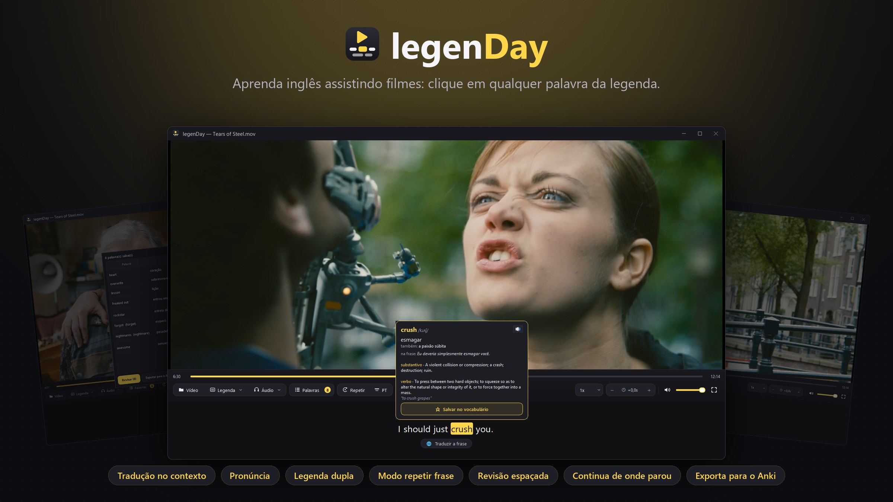

Assista a filmes e pratique inglês: abra um vídeo e uma legenda que você já tem no computador,
**clique em qualquer palavra** e veja a tradução em português, com a fala inteira traduzida, a pronúncia e a
definição. O vídeo pausa sozinho e continua quando você fecha o pop-up. Depois, revise as palavras em cartões,
ouvindo de novo a cena em que cada uma apareceu.

> Projeto open source, 100% gratuito. Não distribui filmes nem legendas: usa os arquivos do próprio usuário.

> **In English:** legenDay is a free, open-source desktop video player (Windows; Python + Qt + mpv) for
> Brazilian Portuguese speakers learning English. Click any word of the subtitle to get a translation in
> context, alternative meanings, pronunciation and dictionary definitions; save words with the movie line they
> came from, review them as spaced-repetition flashcards that replay the original scene, or export them to Anki.
> It also has dual subtitles (English + Portuguese), a "shadowing" mode that pauses after every line so you can
> repeat it out loud, embedded-subtitle extraction and subtitle sync tools.

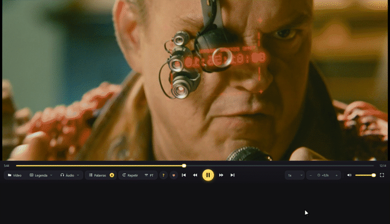

<sub>Também em vídeo: [docs/demo.mp4](docs/demo.mp4).</sub>

## Recursos

**Para entender o filme**
- **Legenda clicável:** clique numa palavra, use **Shift+clique** para uma expressão, ou traduza a frase inteira.
- **Tradução no contexto:** além da tradução da palavra, o pop-up mostra os outros sentidos dela e a fala inteira
  traduzida, para você saber qual sentido o personagem usou.
- **Pronúncia:** 🔊 toca a gravação da palavra feita por uma pessoa de verdade
  ([Wikimedia Commons](https://commons.wikimedia.org)).
- **Dicionário:** forma base (*went → go*), transcrição fonética e definições em inglês.
- **Legenda dupla:** a fala em português aparece embaixo da inglesa, a partir de um `.srt` em português ou
  traduzida na hora.

**Para treinar**
- **Modo repetir frase** (*shadowing*): o vídeo pausa no fim de cada fala para você repetir em voz alta.
- **Revisão espaçada:** cartões com as palavras salvas, no dia certo. Errou, a palavra volta hoje; acertou, volta
  daqui a alguns dias. Um clique toca a cena do filme em que a palavra apareceu.
- **Vocabulário e Anki:** palavras salvas ficam destacadas em amarelo nas próximas legendas e podem ser
  exportadas para o Anki.

**Player**
- Baseado no [mpv](https://mpv.io): toca praticamente qualquer formato (MP4, MKV, AVI, WebM...).
- **Legendas embutidas:** lê as legendas de dentro do MKV/MP4 e, sem faixa marcada como inglês, descobre pelo
  texto qual é a inglesa (o programa baixado já traz o ffmpeg; rodando pelo código, veja abaixo).
- **Escolha do áudio:** em vídeos dublados, começa pelo áudio em inglês e deixa trocar no botão **Áudio**.
- **Ajuste de sincronia** da legenda, lembrado para cada arquivo, e alinhamento com a fala numa tecla.
- **Continue de onde parou:** o app lembra onde cada vídeo parou e pergunta se quer continuar.
- **Fácil para quem nunca usou:** tour guiado na primeira vez, arrastar e soltar vídeo e legenda, e aviso quando
  sai uma versão nova.
- Barra de tempo clicável, pular 10s, repetir/voltar frase, velocidade, volume e tela cheia.

Tradução offline ([Argos Translate](https://github.com/argosopentech/argos-translate), opcional) ou online gratuita
([MyMemory](https://mymemory.translated.net)); definições da [Free Dictionary API](https://dictionaryapi.dev).
Tudo com cache local em SQLite: a segunda consulta é instantânea.

## Telas

| | |
|---|---|
| 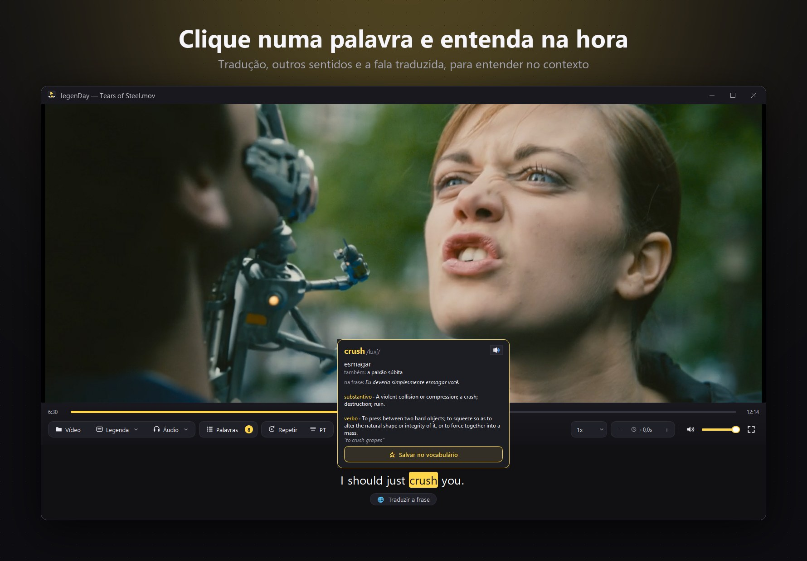 | 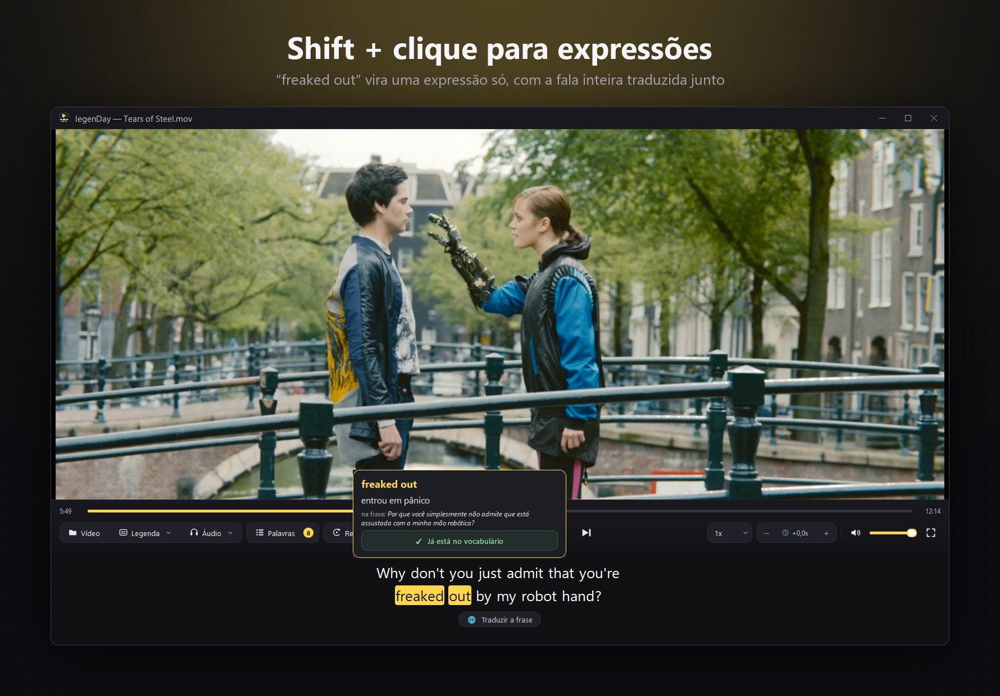 |
| 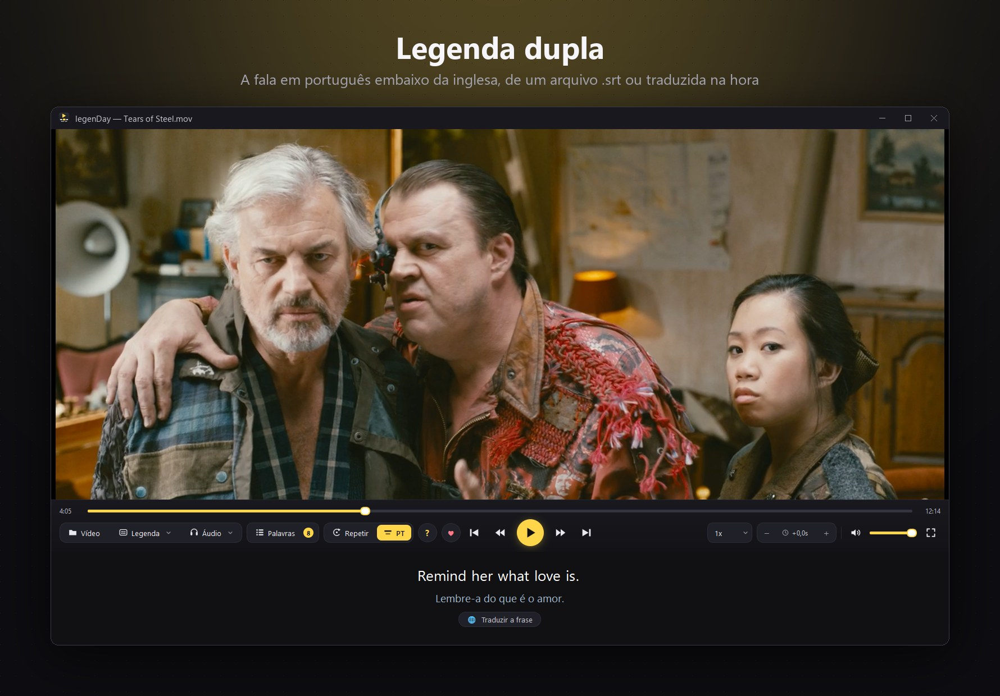 | 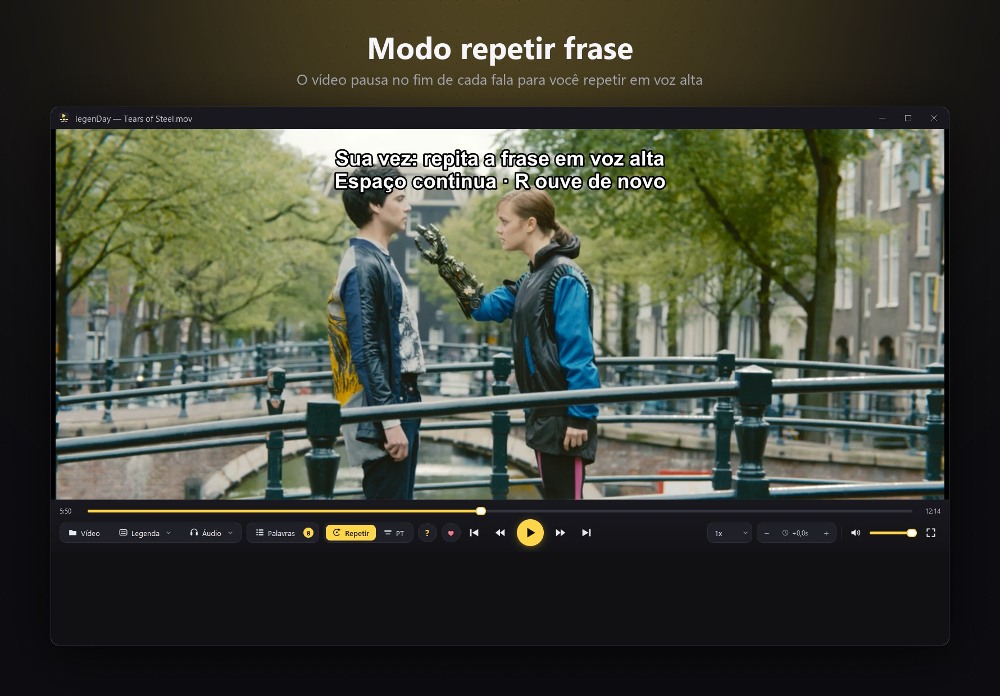 |
| 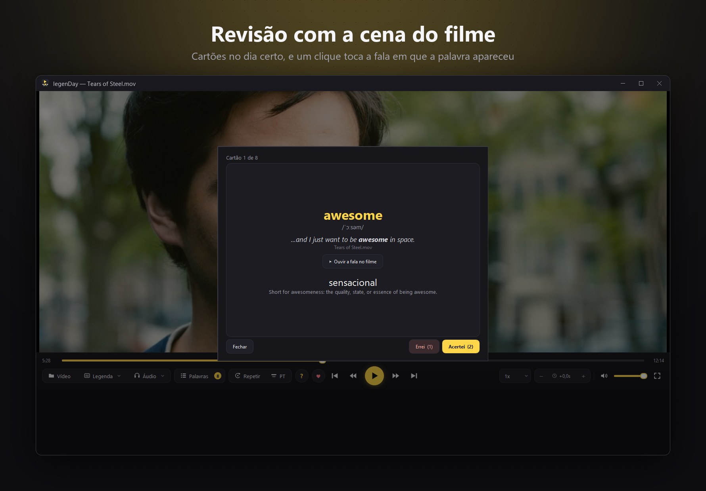 | 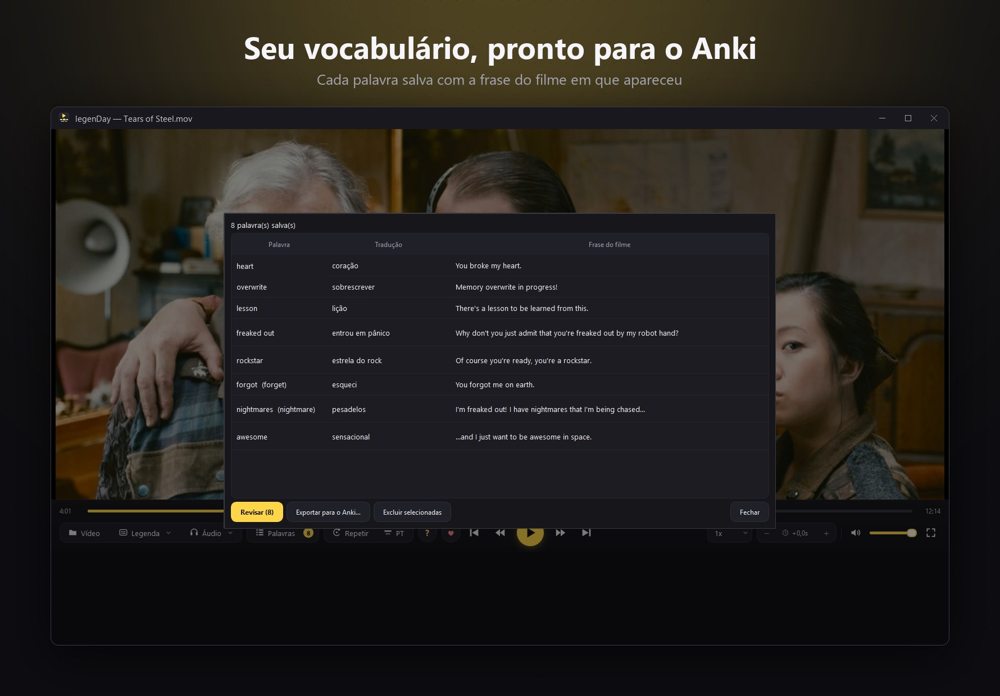 |
| 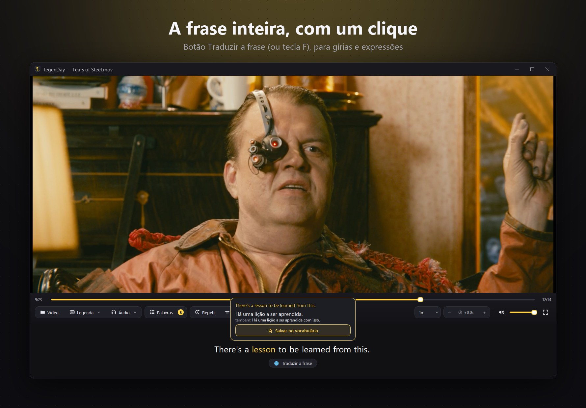 | 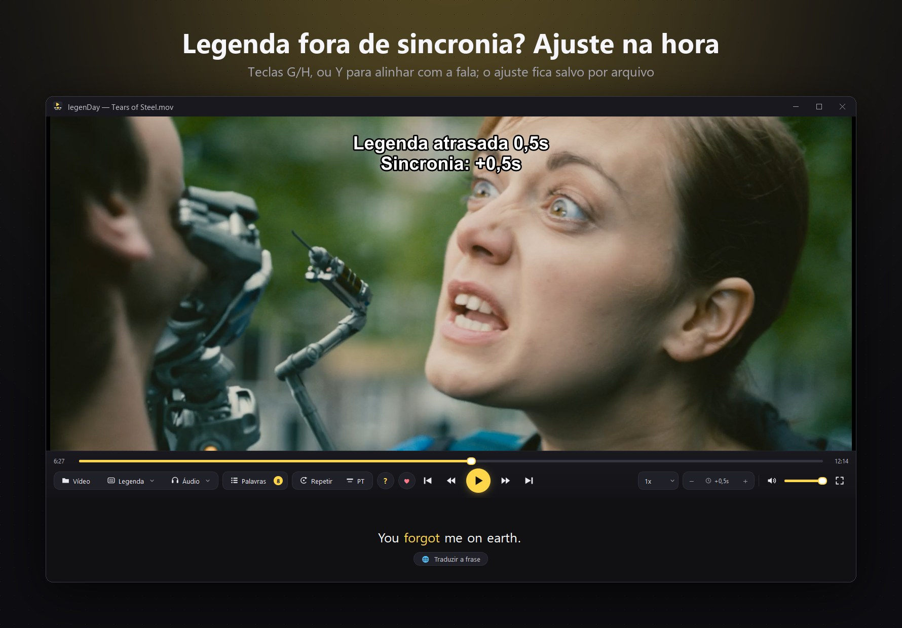 |
| 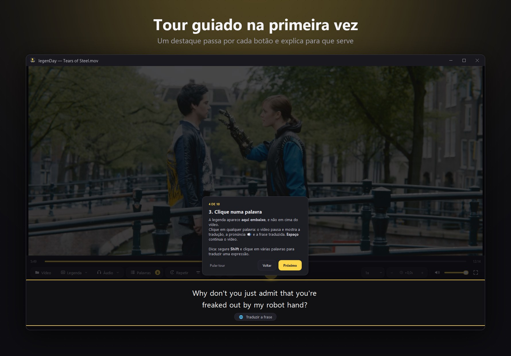 | 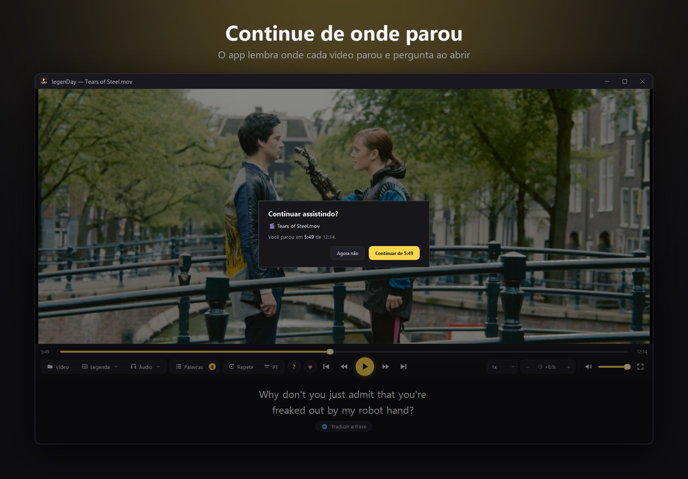 |

<sub>Cenas de <a href="https://mango.blender.org">Tears of Steel</a> (CC BY 3.0) © Blender Foundation | mango.blender.org.</sub>

## Baixar e usar (Windows)

<p align="center">
  <a href="https://github.com/Araujo96/legenday/releases/latest/download/legenDay-Setup.exe"><b>⬇ Baixar o legenDay para Windows</b></a>
</p>

1. Baixe o **`legenDay-Setup.exe`** (link acima ou na página de
   [Releases](https://github.com/Araujo96/legenday/releases/latest)).
2. Dê dois cliques nele e siga o instalador. Ele cria os atalhos na área de trabalho e no menu Iniciar e já abre
   o app. Não pede senha de administrador e não precisa instalar Python nem mais nada.

Para atualizar, é só rodar o instalador da versão nova (suas palavras salvas continuam). Prefere sem instalar?
Na mesma página há o `legenDay-windows-x64.zip`: extraia e abra o `legenDay.exe`.

> **O Windows mostrou "O Windows protegeu o computador"?** É normal em programas novos que ainda não têm
> assinatura digital. Clique em **Mais informações** e depois em **Executar assim mesmo**. O código-fonte é
> aberto e está neste repositório. Alguns antivírus também podem desconfiar de programas feitos com PyInstaller;
> se isso acontecer, prefira instalar pelo Python (abaixo).

Na primeira vez, um tour rápido mostra para que serve cada botão. Quando sair uma versão nova, o app avisa no
rodapé com um botão para baixar.

Para quem prefere instalar pelo Python (ou quer ajudar a desenvolver):

## Instalação com Python (Windows)

1. Instale o Python 3.10 ou superior.
2. Clone o repositório e instale:
   ```
   git clone https://github.com/Araujo96/legenday.git
   cd legenday
   python -m venv .venv
   .venv\Scripts\activate
   pip install -e .
   ```
3. Coloque o `libmpv-2.dll` na pasta `libs/` (veja [libs/README.md](libs/README.md)).
   (Alternativa: defina a variável de ambiente `LEGENDAY_MPV_DIR` com a pasta onde está a DLL.)
4. Execute:
   ```
   python -m legenday
   python -m legenday filme.mkv filme.srt
   ```

Se existir uma legenda com o mesmo nome do vídeo na mesma pasta, ela é carregada automaticamente
(`Filme.srt` ou `Filme.en.srt`). Uma legenda em português ao lado (`Filme.pt-BR.srt`) vira a 2ª linha da
legenda dupla.

### Legendas embutidas no vídeo (opcional)

Para ler legendas que estão dentro do arquivo MKV/MP4, o app usa o ffmpeg. A forma mais simples:

```
pip install -e ".[embedded]"
```

Se você já tem o ffmpeg instalado (no PATH) ou coloca o `ffmpeg.exe` em `libs/`, ele é usado no lugar.
Sem legenda ao lado do vídeo, o app carrega sozinho a faixa em inglês; as demais ficam no menu **Legenda**.
Legendas em imagem (PGS/VobSub) não são suportadas.

### Tradução offline (opcional)

```
pip install -e ".[offline]"
python tools/install_argos_model.py
```

## Atalhos

| Ação | Como |
|---|---|
| Traduzir palavra | clique nela |
| Traduzir expressão | clique na 1ª palavra e **Shift+clique** na última |
| Traduzir a frase toda | botão **Traduzir a frase** (abaixo da legenda) ou tecla **F** |
| Ouvir a pronúncia | 🔊 no pop-up |
| Play/pause (fecha o pop-up) | Espaço, Enter ou um clique no vídeo |
| Modo repetir frase | botão **Repetir** ou tecla **P** |
| Legenda dupla (português embaixo) | botão **PT** ou tecla **T** |
| Repetir frase / frase anterior | botão de frase anterior ou tecla **R** |
| Voltar/avançar | botões ±10s, setas ←/→ ±5s |
| Pular para qualquer ponto | clique ou arraste na barra de tempo |
| Salvar palavra | botão "Salvar no vocabulário" no pop-up |
| Revisar / exportar vocabulário | botão **Palavras** → **Revisar** (Espaço mostra a resposta, **1** errei, **2** acertei) |
| Ajustar sincronia da legenda | **G** adianta, **H** atrasa (0,1s); com **Shift**, 1s; ou botões − / + |
| Alinhar a legenda com a fala | **Y** (quando ouvir o início de uma frase) |
| Tela cheia | dois cliques no vídeo, botão no canto direito da barra ou **F11** (Esc sai) |
| Ajuda e atalhos dentro do app | botão **?** ou **F1** |

## Exportar para o Anki

Botão **Palavras → Exportar para o Anki…** gera um arquivo `.txt`. No Anki, use **Arquivo → Importar**:
frente = palavra (com pronúncia), verso = tradução, definição e a frase do filme com a palavra em negrito;
as tags incluem o nome do filme.

## Como o código é organizado

O código é dividido em camadas: `core` não depende de interface nem de internet, `services` cuida da internet,
`playback` do mpv e `ui` das janelas. Cada camada só usa as de baixo, e os testes seguem a mesma divisão.

```
src/legenday/
  app.py                  ponto de entrada (e o autoteste do executável: --selftest)
  branding.py             nome, ícone e link do projeto
  core/                   sem interface e sem internet
    subtitles.py            leitura de legendas (SRT, ASS, VTT) e busca das legendas ao lado do vídeo
    embedded.py             legendas embutidas via ffmpeg
    audio_tracks.py         faixas de áudio do vídeo (e a preferência pelo inglês)
    study.py                modo repetir frase e agenda da revisão espaçada
    vocab.py                vocabulário em SQLite, revisão e exportação para o Anki
    lemma.py                forma base das palavras (simplemma, offline)
    settings.py             preferências e sincronia de cada legenda (JSON)
    paths.py                pasta de dados e acesso ao SQLite
  services/               tudo que usa a internet (sempre com cache local)
    translator.py           MyMemory / Argos, sentidos alternativos e limpeza dos resultados
    dictionary.py           Free Dictionary API
    pronunciation.py        gravações do Wikimedia Commons
    lookup.py               junta tradução, contexto, forma base, dicionário e pronúncia
  playback/
    mpv_loader.py           encontra e carrega o libmpv
    player.py               acesso protegido ao mpv (nos testes, um player falso entra no lugar)
  ui/                     interface (Qt)
    main_window.py          janela principal: junta as partes
    controls.py             barra de controles (só emite sinais; não conhece o mpv)
    subtitle_view.py        legenda clicável, palavra por palavra
    translation_flow.py     clique → pop-up em duas etapas (tradução primeiro, detalhes depois)
    popup.py                o pop-up
    dual.py                 legenda dupla
    review_dialog.py        cartões de revisão
    vocab_dialog.py         lista de palavras salvas
    help_dialog.py          ajuda dentro do app
    workers.py              tarefas em segundo plano (a interface nunca espera a rede)
    icons.py, style.py      ícones desenhados em código e cores/estilos
tests/                    core/, services/ e ui/ (pytest + pytest-qt)
packaging/                receita do executável do Windows (PyInstaller)
docs/                     imagens e vídeo de demonstração
libs/                     coloque aqui o libmpv (não versionado)
```

## Desenvolvimento

```
pip install -e ".[dev]"
pytest            # inclui os testes de interface; sem tela, use QT_QPA_PLATFORM=offscreen
ruff check .
```

O CI roda o lint e os testes no Linux e no Windows, em Python 3.10 e 3.12.

## Licença

[MIT](LICENSE). O app usa PySide6 (LGPL), mpv/libmpv (LGPL/GPL conforme o build) e pysubs2 (MIT).
O libmpv não é distribuído neste repositório; o pacote para Windows o inclui junto (veja
[THIRD_PARTY_NOTICES.md](THIRD_PARTY_NOTICES.md) para os componentes de terceiros e suas licenças).
As gravações de pronúncia vêm do Wikimedia Commons (achadas também pelo Wiktionary), sob as licenças livres de
cada arquivo. São baixadas quando a palavra é consultada e guardadas na pasta de dados (não fazem parte do app).
